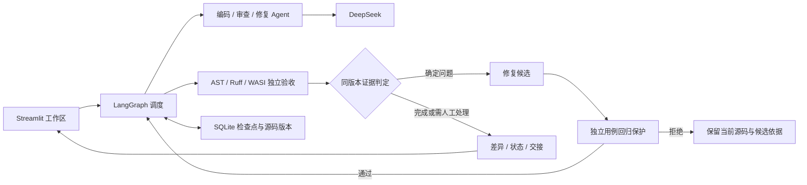

# Codelens_Pro · 多 Agent 代码审查与修复

[](https://github.com/KADG777/Codelens_Pro/actions/workflows/ci.yml)

基于 [CodeLens](https://github.com/KADG777/CodeLens)，将编码、审查、修复与独立验收组织成可追踪、可恢复的工作流。支持需求生成或上传 Python 单文件，在同一工作区查看源码、红绿差异、节点状态和每次修改的依据。

## 快速运行

已验证环境：**Windows、Python 3.12**。在项目目录执行：

```powershell
git clone https://github.com/KADG777/Codelens_Pro.git
cd Codelens_Pro
.\install.cmd
.\start.cmd
```

打开 [本地应用](http://127.0.0.1:8503)。首次使用无需模型密钥：

1. 选择**流程演示**，载入订单修复示例。
2. 选择**便携功能验收**，开始运行。
3. 查看最终验收记录，再打开更改对比和节点交接：红色是删除行，绿色是新增行。

此演示使用预设角色响应，WASI 用例实际执行；预期终态是 `completed_verified`。它证明流程可运行，真实模型效果见下文实验。

真实模型模式：复制 `.env.example` 为本地 `.env`，填写自己的 DeepSeek 配置，再在页面切换模式。任务与源码会发送到配置的服务并产生费用。`.env`、上传源码、运行数据库和个人报告不进入 Git 或源码包；CI 不需要模型密钥。

## 协作机制

| 能力 | 如何核对 |
|---|---|
| 源码修复 | 保存原版本，采用修复候选后生成新版本；在上传工作区查看红绿差异 |
| 条件、循环与并行 | 首稿通过可结束；确定问题进入最多两轮修复；审查与验收可并行 |
| 可执行画布 | 拖动与连线、条件分支、并行汇合、JSON 导入导出，配置经校验后执行 |
| 状态追踪 | 当前路径、耗时、失败原因；点击节点查看各轮输入输出 |
| 证据与恢复 | 用源码哈希关联失败用例、修复版本和复验；SQLite 保存检查点 |
| 角色扩展 | 注册统一输入输出合同；内置可选验收解读 Agent 展示扩展方式 |



上传已有源码时跳过编码；Agent 负责生成、分析或修复，程序负责隔离执行、预算和最终判定。绑定合同的便携真实模型任务默认使用精简审查与候选保护；完整工具审查仍可选。审查计划完成后复用反例，模型预期只作为待核对意见，不能授权改码或否决候选。详见 [系统设计](docs/DESIGN.md)。

## 实测效果与适用范围

最近一次完整工程复测：**4 个内部合成任务 × 3 次重复 × 3 组**，使用相同任务与冻结评分；属于同任务工程复测，非外部盲测。

| 方法 | 最终源码独立评分通过 | 模型调用 | token | 处理耗时合计 |
|---|---:|---:|---:|---:|
| 直接处理 | 11/12 | 12 | 12,441 | 29.85 秒 |
| 单 Agent + 测试 | 12/12 | 13 | 14,065 | 46.78 秒 |
| 精简 Workflow | 11/12 | 33 | 63,131 | 188.03 秒 |

三组均无已测用例回归。Workflow 正常完成公开验收是 **9/12**，最终源码评分是 **11/12**，两者分别统计。最终规则修正了模型预期误拦截，原候选回放与一次真实重跑均通过；这项定点验证不改写整套成绩。

Workflow 在该复测中仍使用约 **4.49 倍于单 Agent + 测试的 token**，没有证明更高的成功率。项目适合需要角色分工、独立验收、审计与恢复的场景；简单纯函数任务的经济基线仍是单 Agent + 测试。该基线目前是实验工具，应用没有自动切换到单 Agent 的产品模式。

完整历史、失败及评分口径见 [实验总览](docs/AGENT_VALUE_EXPERIMENT.md)；资源开销分析与待验证优化见 [成本与可靠性](docs/OPTIMIZATION.md)。自动修复范围为 Python 单文件；便携验收面向标准库纯函数，不覆盖 TensorFlow、摄像头或多文件项目。红绿差异只表示文本变化，性能提升需要同条件实测。

## 验证与常见问题

已完成 **432 项离线工程回归**；角色使用模拟模型，WASI 检查实际执行。[GitHub CI](https://github.com/KADG777/Codelens_Pro/actions/workflows/ci.yml) 自动检查依赖、代码、完整测试、发布内容及凭证，并提供源码包。范围见 [验证记录](docs/VALIDATION.md)。

```powershell
.\.venv\Scripts\python.exe -m ruff check .
.\.venv\Scripts\python.exe -m pytest tests tests_workflow -q
```

| 情况 | 处理方式 |
|---|---|
| 默认端口被占用 | 使用 `.\start.cmd -Port 8504`，打开对应端口 |
| 自定义代码无法开始功能验收 | 绑定匹配的 TaskSpec 合同；无合同先选静态检查 |
| 只有原版本，没有红绿变化 | 查看终止原因；首稿正确、无进展或候选被拒绝都可能不产生新版本 |
| `blocked` / `needs_attention` | 查看节点错误、失败用例和未解决项；仅可恢复错误沿原检查点与预算继续 |

## 代码与文档导航

`app.py` 是主入口；`ui/`、`pages/` 提供界面；`workflow/` 管理协作与验收；`review_agent/` 保留原审查能力；`evals/` 保存冻结任务和原始证据；`tests/`、`tests_workflow/` 提供回归。工具集中在 `scripts/`，便携运行时与许可证在 `sandbox_runtime/`。`data/`、`reports/`、`.venv/` 仅供本地运行。

| 阅读目的 | 文档 |
|---|---|
| 理解架构、状态、预算和恢复 | [系统设计](docs/DESIGN.md) |
| 修改编排或新增 Agent | [画布](docs/EXECUTABLE_CANVAS.md) / [角色扩展](docs/AGENT_EXTENSIONS.md) |
| 核对模型效果与额外开销 | [实验总览](docs/AGENT_VALUE_EXPERIMENT.md) / [成本分析](docs/OPTIMIZATION.md) |
| 复现工程检查、运行工具或下载包 | [验证记录](docs/VALIDATION.md) / [CI](docs/CI.md) / [工具入口](scripts/README.md) |
| 对照作业要求、准备演示 | [交付证据](docs/SCORE_MAP.md) / [一分钟演示](docs/DEMO.md) |
