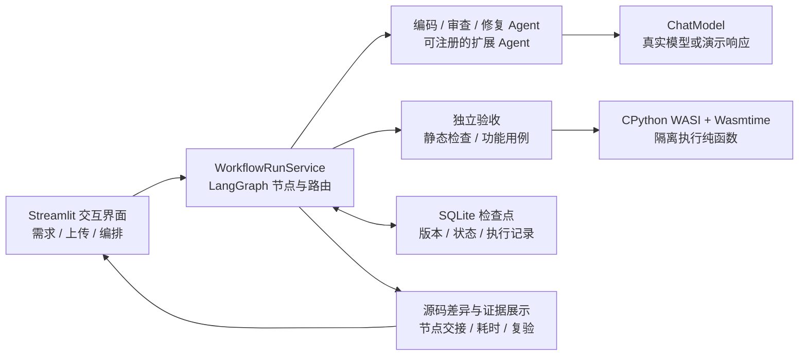
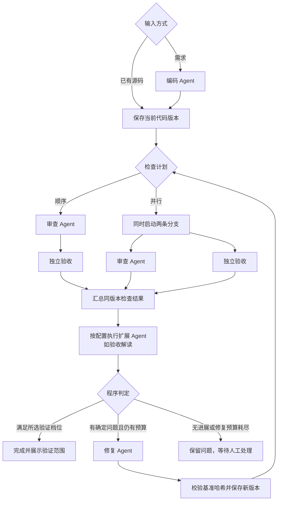

# Codelens_Pro · 多 Agent 代码审查与修复工作流

[](https://github.com/KADG777/Codelens_Pro/actions/workflows/ci.yml)

Codelens_Pro 在 [CodeLens 代码审查 Agent](https://github.com/KADG777/CodeLens) 的基础上，加入编码与修复角色，形成 **编码 → 审查 → 修复 → 重新验收** 的协作流程。用户可以从需求生成代码，也可以上传已有 Python 单文件，在同一个工作区查看修复后的完整源码、红绿差异、问题依据和执行状态。

项目使用 Python、Streamlit 和 LangGraph 构建。模型负责生成、分析和修复；程序负责流程控制、版本管理、独立验收与结果判定。原版 Python / C++ 审查入口继续保留。

## 阅读导航

- [核心功能](#核心功能)
- [系统架构](#系统架构)
- [工作流程](#工作流程)
- [关键设计](#关键设计)
- [快速开始](#快速开始)
- [项目结构](#项目结构)
- [测试与评估](#测试与评估)
- [适用范围与文档](#适用范围与文档)

## 核心功能

| 功能 | 实际行为 |
|---|---|
| 两种输入方式 | 从需求生成代码，或上传、粘贴已有 Python 源码；已有代码直接进入检查 |
| 自动修复与差异 | 修复 Agent 返回完整源码，更新应用内当前版本；左侧红色显示删除，右侧绿色显示新增 |
| 可执行画布 | 拖动节点、连线、条件分支、并行汇合、已注册 Agent 与有界修复循环；JSON 导入导出 |
| 执行状态追踪 | 高亮实际路径，展示节点耗时、失败原因；点击节点查看各轮输入与输出交接 |
| 问题到验收的追踪 | 关联审查意见或失败用例、修复版本、对应修改以及新版本复验结果 |
| 恢复与导出 | 从检查点继续可恢复任务，保留历史版本；下载完整源码和 Markdown 运行报告 |

修复发生在应用管理的代码版本中，原始上传文件保留。未修改的行保持普通背景，红绿差异表示文本变化，功能是否正确由对应版本的验收记录说明。

## 系统架构

系统通过 `WorkflowRunService` 统一创建、执行和恢复任务。界面、流程调度、Agent、验证器与存储分开实现，网页和命令行共享同一工作流服务。



### Agent 分工

| 角色 | 输入 | 输出与职责 |
|---|---|---|
| 编码 Agent | 用户需求、公开接口与验收合同 | 生成完整 Python 源码；上传已有源码时跳过 |
| 审查 Agent | 当前源码、需求、本地工具反馈 | 形成问题、待确认项和需求核对结果；复用原 CodeLens 的工具循环与反思复核 |
| 修复 Agent | 同一版本的源码、确定问题、失败用例 | 返回绑定基准源码哈希的完整修复代码、修改说明及未解决项 |
| 验收解读 Agent（可选） | 已保存的审查结果与验收记录 | 解释风险与下一步，作为角色注册机制的实际接入示例 |

角色可共用同一模型服务，通过各自提示词和结构化交接承担不同职责。独立验收、并行汇合与最终通过判定由程序实现；解读 Agent 的说明不能改变验收结论。

### 模块职责与技术选型

| 层次 | 主要实现 | 职责 |
|---|---|---|
| 交互层 | `app.py`、`ui/`、`pages/` · Streamlit | 输入、编排、运行状态、差异和评测展示 |
| 编排层 | `workflow/service.py`、`canvas.py`、`canvas_runtime.py` · LangGraph | 图校验、按连线调度、条件路由、并行汇合、预算与恢复 |
| 角色层 | `workflow/agents.py`、`review_agent/` | 编码、工具辅助审查、反思复核和修复交接 |
| 合同与扩展 | `models.py`、`registry.py`、`node_registry.py` · Pydantic | 统一数据结构、任务验收合同和扩展角色注册 |
| 验证层 | `workflow/validation.py`、`wasi_runtime.py` | AST / Ruff / 接口检查，以及 CPython WASI 功能用例 |
| 记录层 | SQLite 检查点、`workflow/tracing.py` | 保存源码版本、审查与验收历史、节点耗时和交接内容 |
| 工程验证 | pytest、Ruff、GitHub Actions | 自动回归、依赖检查、运行时校验和源码包生成 |

## 工作流程



上图展示标准模板。启用画布后，连线决定实际顺序与并行分支，条件节点决定执行或跳过；读同一版本的分支汇合后才进入修复。首次检查已满足要求的任务可以直接完成。画布操作与调度细节见 [可执行画布](docs/EXECUTABLE_CANVAS.md)。

运行支持首次检查后暂停，以及模型或环境错误后的恢复。顺序模式在审查提交后暂停，并行模式在检查汇合后暂停；同版本已经成功的并行分支可以在恢复时复用。

## 关键设计

### 1. 结构化交接与版本绑定

编码、修复和扩展节点使用 Pydantic 合同校验输入输出。每个代码版本都有 SHA-256、父版本和来源，审查、验收与修复结果绑定相应源码哈希。修复响应必须指向当前基准版本，旧版本结果不能授权新版本通过。

修复 Agent 输出完整源码，程序校验后保存新版本，再重新审查和验收。仅修改注释、空白或文档字符串不会被当作实质功能修复。

### 2. 审查意见与功能证据分别记录

审查意见通过问题 ID、原样源码和位置关联修改；失败用例通过 `V-用例ID`、版本及实际返回值关联修复和复验。界面区分“模型声明已处理”“复查未再检出”和“同一用例实际通过”。

| 运行结果 | 含义 |
|---|---|
| 静态检查通过，功能待验证 | 通过本次静态检查，没有执行功能用例 |
| 功能验收通过 | 当前版本的公开合同用例实际执行通过，且无阻断项 |
| 需人工处理 / 环境阻塞 | 问题、信息缺口、无进展或环境错误仍被保留 |

需要功能验收时，任务必须绑定已注册的验收合同；缺失或不兼容的配置在开始前拦截。功能验证使用受限的 WASI 运行时，实际期望值由宿主判定器比较。

### 3. 持久状态、可视状态与恢复

SQLite 检查点保存任务、执行计划、版本、审查与验收记录、预算和恢复位置。节点记录包含开始与结束时间、耗时、轮次、错误及输入输出，供运行图和追踪界面使用。

“正在执行”高亮来自实时通知；已保存的结果来自提交后的检查点。恢复沿用原预算，模型调用、token 和活动时间均受限；有界修复最多两轮。该机制面向本地工作流，不提供分布式事务或外部请求严格只执行一次的保证。

### 4. 任务扩展与 Agent 扩展

- **任务扩展**：通过 `TaskSpec` 注册函数接口和验收合同，内置订单统计、文本统计、区间合并等 10 类任务。
- **Agent 扩展**：通过 `NodeRegistry` 注册节点 ID、版本、输入输出合同和可读字段。角色获得声明字段的副本，将结果写入自己的节点记录；新增角色无需逐个修改中心分发逻辑。

模板中的扩展按配置顺序执行；画布中可连接为并行或条件分支，只要满足声明的读取依赖。最多 16 个扩展角色，画布总计不超过 24 个节点、64 条边。内置验收解读 Agent 已实际接入，编码与修复等源码写入角色使用专用适配器。详见 [Agent 扩展说明](docs/AGENT_EXTENSIONS.md)。

## 快速开始

推荐使用 **Windows + Python 3.12**。锁定依赖要求 Python 3.12 或更高版本，当前自动化验证使用 3.12。

```powershell
git clone https://github.com/KADG777/Codelens_Pro.git
cd Codelens_Pro
.\install.cmd
.\start.cmd
```

安装需要网络。启动后访问 [本地应用](http://127.0.0.1:8503)；端口被占用时可运行 `.\start.cmd -Port 8504`。启动器支持中文与空格路径，`.\start.cmd -CheckOnly` 仅检查环境。

### 无密钥体验

选择“流程演示（无需密钥）”和“订单修复闭环”，载入场景示例，通过“从需求生成”开始运行。默认静态检查即可查看修复和红绿差异；选择便携功能验收可执行合同用例。

演示使用预设角色响应和实际本地检查，API 调用为 0。订单与文本统计提供预设演示；自定义任务使用真实模型。

### 使用真实模型

将 `.env.example` 复制为 `.env`，填写自己的 DeepSeek 配置；也可在侧栏选择真实模型并填写连接信息。运行会将任务与源码发送到配置的服务并产生 API 费用，`.env` 已被 Git 忽略。

CI 无需配置模型密钥。发布前的凭证检查覆盖源文件、Git 暂存内容、提交历史与源码 ZIP；本机存在 `DEEPSEEK_API_KEY` 时额外做实际值匹配，只输出检查结果，不打印密钥。

上传代码后设置任务目标，选择检查方式和修复轮数，再开始运行。查看“代码工作区”的前后差异，或选择审查问题、失败用例和流程节点追踪结果。完整安装与发布步骤见 [GitHub 上传指南](docs/GITHUB_UPLOAD.md)。

## 项目结构

```text
Codelens_Pro/
├── app.py                    # 主工作区
├── workflow/                 # 编排、角色适配、状态、验收与扩展
├── review_agent/             # 原 CodeLens 审查 Agent 与工具
├── ui/                       # 流程图、源码差异、证据与评测展示
├── pages/                    # 原版审查、评测与验收页面
├── sandbox_runtime/          # 便携 Python WASI 归档与许可证
├── examples/                 # 合成示例代码
├── evals/                    # 任务集与可公开的评测结果
├── tests/                    # 原审查功能测试
├── tests_workflow/           # 工作流、恢复、隔离验收与界面测试
├── docs/                     # 设计、验证、扩展与使用说明
├── scripts/                  # 发布文件校验
├── .github/workflows/ci.yml  # GitHub CI
├── run_demo.py               # 命令行演示
├── compare_workflows.py      # 同任务对照实验
├── compare_agent_value.py    # 三组重复实验
├── evaluate_recovery.py      # 零 API 故障注入
└── package_release.py        # 源码打包
```

`data/`、`reports/` 和 `.venv/` 在本地运行时生成，不进入 Git 或公开源码包。

## 测试与评估

### 自动化检查

2026-10-23 在 Python 3.12.9 环境中完成 **410 项测试，全数通过**。覆盖工具与证据校验、分支和循环、并行汇合、暂停恢复、版本一致性、真实 WASI 用例、界面以及 Windows 启动器。

```powershell
.\.venv\Scripts\python.exe -m ruff check .
.\.venv\Scripts\python.exe -m pytest tests tests_workflow -q
```

[GitHub CI](https://github.com/KADG777/Codelens_Pro/actions/workflows/ci.yml) 在推送、Pull Request 和手动触发时执行检查、完整测试、运行时校验及打包，并提供测试报告与源码包下载。测试使用演示响应或模拟模型，不需要 API Key。顶部徽章显示 `main` 分支的工作流状态。

### 同任务真实模型对照

对同一模型配置下的 8 项合成任务进行比较，包含 4 项已有任务与 4 项实验前冻结的新任务。两组输出确定后，使用相同的公开与保留用例独立评分。

| 方式 | 通过 | 回归任务 | 耗时合计 | token |
|---|---:|---:|---:|---:|
| 单模型直接处理 | 8/8 | 0 | 9.76 秒 | 5,227 |
| 完整工作流 | 8/8 | 0 | 165.71 秒 | 193,029 |

这组小规模实验没有测出完整工作流的准确率优势。原始记录保留在 [首轮配对实验](docs/PAIRED_COMPARISON.md)。

随后增加 4 个新任务，每项 3 次重复，并加入同一 Agent 可接收公开测试反馈的对照组：

| 方式 | 通过 / 计划 | 回归用例 | 总耗时 | token |
|---|---:|---:|---:|---:|
| 直接处理 | 11/12 | 0 | 34.03 秒 | 14,570 |
| 单 Agent + 测试修复 | 12/12 | 0 | 50.02 秒 | 14,728 |
| 完整 Workflow | 10/12 | 3 | 311.39 秒 | 311,422 |

这轮仍不支持准确率优势。中间组均首稿通过公开检查，未实际触发反馈修复；三次重复也不能当作三个独立任务。Workflow 的一个超时任务随后从原失败节点恢复并通过全部评分，额外 4 次调用、10,652 token，**不改写主实验的 10/12**。项目可展示的收益是分工交接、同版本独立验收及恢复证据，同时明确其成本。协议、逐项结果与限制见 [三组实验与真实恢复](docs/AGENT_VALUE_EXPERIMENT.md)。

## 适用范围与文档

当前自动编码与修复针对 **Python 单文件**，便携功能验收针对标准库纯函数。原版入口支持 Python / C++ 审查；C++ 编译、自动修复，TensorFlow 或摄像头等依赖环境不在当前功能验收范围。画布支持合法检查子图的拖拽连线及实际调度，保留必须执行的审查 / 验收和受限修复回路；不支持任意无界循环、上传可执行条件、分布式调度或多人编辑。

| 文档 | 内容 |
|---|---|
| [系统设计](docs/DESIGN.md) | 节点路由、状态、并行、版本与恢复细节 |
| [可执行画布](docs/EXECUTABLE_CANVAS.md) | 拖拽连线、图校验、分支与调度语义 |
| [三组实验与真实恢复](docs/AGENT_VALUE_EXPERIMENT.md) | 重复试验、成本、负面结果与恢复证据 |
| [Agent 扩展](docs/AGENT_EXTENSIONS.md) | 节点合同、注册示例和扩展范围 |
| [验证记录](docs/VALIDATION.md) | 已完成检查与实际验证边界 |
| [工作流评测](docs/WORKFLOW_EVALUATION.md) | 独立审核、指标与复现方式 |
| [同任务对照](docs/PAIRED_COMPARISON.md) | 单模型与完整工作流的配对实验 |
| [CI 说明](docs/CI.md) | 自动化步骤、产物及本地复现 |
| [GitHub 上传指南](docs/GITHUB_UPLOAD.md) | 仓库发布和后续更新 |
| [演示脚本](docs/DEMO.md) | 一分钟展示流程 |
