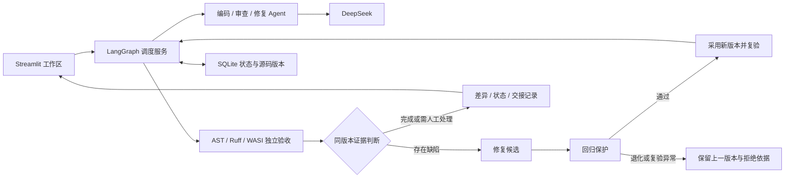

# Codelens_Pro · 多 Agent 代码审查与修复

[](https://github.com/KADG777/Codelens_Pro/actions/workflows/ci.yml)

在 [CodeLens](https://github.com/KADG777/CodeLens) 的审查能力上，加入编码、修复与独立验收，形成 **编码 → 审查 → 修复 → 重新验收** 的工作流。支持上传 Python 单文件，直接查看当前源码、红绿差异、节点状态与修改依据。

## 快速开始

Windows + Python 3.12：

```powershell
git clone https://github.com/KADG777/Codelens_Pro.git
cd Codelens_Pro
.\install.cmd
.\start.cmd
```

打开 [本地应用](http://127.0.0.1:8503)。端口占用时使用 `.\start.cmd -Port 8504`。

- **无密钥体验**：选择流程演示，载入订单修复示例，使用便携功能验收查看修复闭环。角色响应为预设，检查实际执行。
- **真实模型**：复制 `.env.example` 为 `.env`，填写 DeepSeek 配置。任务和源码会发送到所配置的服务并产生费用。
- **已有源码**：上传或粘贴 Python 文件，填写目标。功能验收须绑定匹配的任务合同；自定义代码可先进行静态审查。

API Key 仅在运行时使用；`.env`、本地数据库和缓存不进入源码包。CI 使用模拟模型，不需要真实密钥。发布检查覆盖源文件、暂存内容、提交历史及 ZIP，输出不包含密钥值。

## 功能与架构

| 功能 | 实际行为 |
|---|---|
| 源码修复 | 保存原始版本；修复工作副本，红色展示删除、绿色展示新增 |
| 可执行画布 | 拖动节点、连线、条件分支、并行汇合、有界修复循环；可导入导出 JSON |
| 可视状态 | 高亮执行路径，展示节点耗时、失败原因及每轮交接 |
| 可追踪性 | 关联失败用例 / 审查意见、修复版本及同版本复验 |
| 恢复能力 | SQLite 检查点保存状态，恢复时复用成功分支的证据 |
| Agent 扩展 | 通过统一输入输出合同注册新角色，无需改中心分发逻辑 |



**角色与程序分工**：编码 Agent 生成完整源码；审查 Agent 检查合同并提出反例；修复 Agent 根据证据修改源码。程序负责隔离执行、版本绑定、分支、预算和最终判定。可选验收解读 Agent 只解释结果。

**成本控制**：绑定合同的便携功能验收默认使用精简审查。一次请求完成需求核对与反例设计；修改后重跑保存的反例计划，避免反复付费审查。自动修复依据独立检查，模型反例作为待核对意见。候选采用前检查是否破坏已通过的冻结用例；模型自己提出的预期不能否决正确修复。静态 / 无合同任务继续使用完整工具审查，界面也保留历史策略选项。

**证据边界**：反例预期由模型提出，可能有误，不能代替独立冻结验收。公开验收通过只说明覆盖的用例通过；性能或识别准确率提升需要另做同条件实测。红绿差异表示文本变化。

## 实验与质量

真实实验按冻结协议保存全部结果，隐藏用例不反馈给 Agent。优化前的三组实验为：直接处理 **11/12、14,570 token**；单 Agent + 测试 **12/12、14,728 token**；完整 Workflow **10/12、311,422 token**。这组负面结果促成精简审查与回归保护，原记录保持不变。

旧任务复测 **4/4 通过，共 17,012 token**。随后在 4 个新任务上进行三组重复实验，并完整保留格式失败后的同任务工程复测：直接处理 **11/12、12,441 token**；单 Agent + 测试 **12/12、14,065 token**；Workflow **11/12、63,131 token**，均无已测用例回归。

最后一个 Workflow 失败来自错误的模型预期拦截正确候选；最终修正后，原候选的零 API 回放和该任务的一次真实复测均通过。该定点验证不改写完整实验的 11/12。当前证据支持降低冗余开销与修复错误拦截，**仍不支持普遍准确率或成本优势**。全部协议、失败与用量见 [优化说明与实验](docs/OPTIMIZATION.md)。

```powershell
.\.venv\Scripts\python.exe -m ruff check .
.\.venv\Scripts\python.exe -m pytest tests tests_workflow -q
```

[GitHub CI](https://github.com/KADG777/Codelens_Pro/actions/workflows/ci.yml) 自动执行回归、依赖与运行时检查、凭证扫描和打包。当前已完成的检查见 [验证记录](docs/VALIDATION.md)。

## 项目结构

| 目录 / 文件 | 职责 |
|---|---|
| `app.py`、`ui/`、`pages/` | 主工作区、画布、差异、状态与评测 |
| `workflow/` | 调度、角色、合同、扩展、状态和隔离验收 |
| `review_agent/` | 原 CodeLens 的 Python / C++ 审查与工具 |
| `evals/` | 冻结任务集与可公开实验结果 |
| `tests/`、`tests_workflow/` | 离线回归和真实隔离执行测试 |
| `sandbox_runtime/` | 固定版本的便携 WASI 解释器及许可证 |
| `scripts/`、`.github/workflows/` | 发布检查与 CI |
| `compare_optimized.py` | 优化后对照实验，拒绝覆盖已有报告 |

`data/`、`reports/`、`.venv/` 为本地运行目录，不进入 Git 或发布包。

## 范围与进一步阅读

自动修复针对 **Python 单文件**；便携功能验收针对标准库纯函数。TensorFlow、摄像头等外部依赖需要单独的评测环境。画布支持受约束的检查子图与最多两轮修复，不提供任意无界循环、分布式调度或多人编辑。

| 文档 | 用途 |
|---|---|
| [系统设计](docs/DESIGN.md) / [画布](docs/EXECUTABLE_CANVAS.md) | 状态、路由、并行、版本和恢复语义 |
| [优化与实验](docs/OPTIMIZATION.md) | 本轮改进、真实结果及限制 |
| [Agent 扩展](docs/AGENT_EXTENSIONS.md) | 注册接口与可运行示例 |
| [CI](docs/CI.md) / [发布](docs/GITHUB_UPLOAD.md) | 自动化检查及上传步骤 |
| [演示](docs/DEMO.md) | 展示流程 |
| [历史实验](docs/AGENT_VALUE_EXPERIMENT.md) / [首轮对照](docs/PAIRED_COMPARISON.md) | 保留的原始评测证据 |
