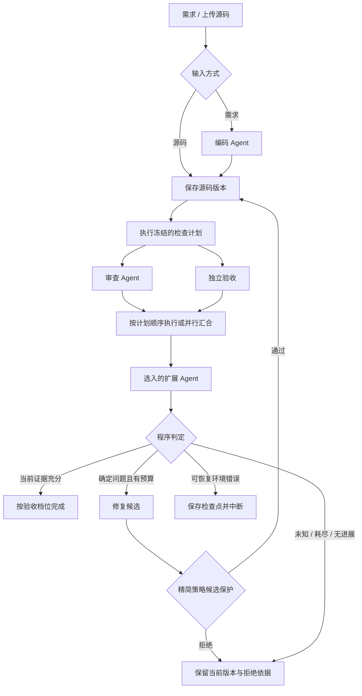

# 系统设计

Codelens_Pro 将原 CodeLens 的审查能力扩展为编码、审查、修复和独立验收的本地工作流。设计目标是使每次源码变更有可核对的依据，并能在失败后保留状态继续。模型效果与工程机制分别验证，成绩见 [实验总览](AGENT_VALUE_EXPERIMENT.md)。

## 分层与责任

| 层 | 实现入口 | 责任 |
|---|---|---|
| 界面 | [app.py](../app.py)、[ui/](../ui/)、[pages/](../pages/) | 输入任务、编排、源码差异、状态和交接展示 |
| 调度 | [service.py](../workflow/service.py)、[canvas_runtime.py](../workflow/canvas_runtime.py) | LangGraph 路由、检查点、并行汇合、预算和恢复 |
| Agent | [agents.py](../workflow/agents.py)、[focused_review.py](../workflow/focused_review.py) | 模型角色、结构化输出及受预算约束的调用 |
| 独立验收 | [validation.py](../workflow/validation.py)、[wasi_runtime.py](../workflow/wasi_runtime.py) | 静态规则、接口检查、隔离执行与宿主评分 |
| 数据与扩展 | [models.py](../workflow/models.py)、[registry.py](../workflow/registry.py)、[node_registry.py](../workflow/node_registry.py) | 版本、合同、交接、任务注册和角色注册 |

| 角色 | 接收 | 产出与权限 |
|---|---|---|
| CodingAgent | 用户任务、公开接口合同 | 完整源码候选，由服务保存；不决定最终通过 |
| ReviewAgent | 当前源码、任务、工具证据 | 问题、待确认项与需求核对；不直接改码 |
| FixAgent | 当前源码、同版本确定目标、公开验证反馈 | 完整修复候选、基准哈希、修改说明与未解决项 |
| 验收解读 Agent（可选） | 同版本审查与验收结果 | 解释风险与下一步；不修改源码或判定 |

角色可共用同一模型服务，以独立提示和结构化交接分工。独立验收是程序执行的检查，不是另一个模型对代码的自评。静态任务保留原 CodeLens 工具循环与反思；精简审查仅用于绑定合同的便携真实模型任务。

## 执行路径

需求入口先编码，上传入口直接保存 v0。首次检查通过即可结束，编码或修复角色未被调用时不计作该次运行的协作证据。



标准模板由 `WorkflowConfig` 冻结顺序、并行和修复选项。画布模式由 `CanvasGraph` 校验、`canvas_runtime` 调度，实际路由来自连线和条件结果，见 [画布执行语义](EXECUTABLE_CANVAS.md)。

顺序模式先审查再验收；标准并行模式通过 `inspect` 同时启动两分支。每个分支读取状态副本，汇合后统一提交结果与增量用量，修复等待两分支完成。图形并排不能证明并发，证据是保存的开始/结束时间及区间交集。并行可缩短等待，但不会自动减少模型调用或 token。

## 状态与证据约束

SQLite 检查点保存任务、冻结计划、合同及哈希、不可变源码版本、当前版本指针、交接、预算、错误和恢复游标。源码和当前指针在同一状态提交，避免“界面显示一版、验收检查另一版”。

| 约束 | 执行结果 |
|---|---|
| 版本一致 | 审查、修复基准和验收必须绑定当前源码哈希；旧证据不能授权新版本通过 |
| 任务权限 | 用户任务决定目标；源码注释和模型说明不能升级为新指令 |
| 证据来源 | 模型提出的反例预期只供核对；实际执行结果不证明该预期正确 |
| 候选采用 | 精简策略采用前复验，保护已通过的独立冻结检查；缺失、跳过或错误也算未保持 |
| 拒绝留痕 | 被拒绝候选、检查、哈希和原因保留；当前源码指针不前移 |
| 评分隔离 | 公开验收可反馈给 Agent；隐藏用例只在候选固定后用于独立评测 |

修复关系分三层展示：模型声明处理、后续复查未再检出、同版本用例实际通过。问题 ID、行段交集和红绿差异提供关联，不等于单个缺陷已被证明修复。没有定位行的功能用例不伪造源码行号。

`node_start` 等临时通知用于运行高亮，带 `transient=True`；提交后的 `node_end` 和 SQLite 快照才是持久证据。`node_runs` 保存每轮耗时、输入输出、错误和用量；旧记录缺失的耗时不补造。

## 成本控制与取舍

| 已实现机制 | 生效条件与边界 |
|---|---|
| 精简审查 `focused` | `mode=live`、便携功能验收且有 TaskSpec；一次逻辑请求核对需求并设计有限反例，协议纠错可能增加实际调用 |
| 反例计划复用 | 已完成有效计划、且不是待实测效果目标时，后续重跑已有反例，避免重复付费审查 |
| 验收缓存 | 同一源码哈希的成功验收可复用；源码变化后须重新绑定和检查 |
| 精简修复交接 | 不重复发送相同任务和源码，区分确定目标、建议与未知项 |
| 有界重试 | 格式修正、瞬态网络重试和业务修复分别记录，并受总预算约束 |
| 可选扩展 | 未选入的角色不执行；解释角色会额外消耗预算 |

默认运行上限为 **30 次模型调用、100,000 token、300 秒活动时间**，业务修复最多 2 轮。这些是停止阈值，不是性能承诺，也不同于对照实验的单组预算。精简策略不会为无实质变化的候选额外调用模型重新考虑；完整策略保留有限的无进展复核。格式、注释或文档字符串变化不算功能修复。

当前界面保留 `focused` / `full` 策略选择，但没有自动切换到单 Agent 的快路径。独立审查与修复角色会带来额外成本；最新完整实验仍未证明它们提高成功率。叶节点调用分解、成本指标和待验证改进见 [成本分析](OPTIMIZATION.md)。

## 验收、终态与恢复

| 验收档位 | 执行范围 |
|---|---|
| `static_only` | AST、Ruff 和接口检查，不执行候选 |
| `functional_portable` | 附带 CPython WASI / Wasmtime，执行标准库纯函数用例 |
| `functional_required` | 保留的 Docker 订单验收；本机尚未完成实际 Docker 测试 |

便携运行时使用前核对固定 SHA-256，只预开标准库和本次工作区的只读目录；不向 guest 提供宿主密钥或网络，并限制时间、指令、内存与输出。guest 返回实际值、异常和调用后输入，宿主比较冻结期望。依赖 TensorFlow、摄像头、任意系统服务的代码需要另行配置评测环境。来源与限制见 [运行时说明](../sandbox_runtime/README.md)。

| 状态 | 含义与下一步 |
|---|---|
| `completed_static` | 静态检查完成，功能未验收 |
| `completed_verified` | 当前源码实际验收通过且没有阻断项；覆盖范围以合同为准 |
| `needs_attention` | 未知、无进展、候选拒绝或预算耗尽；查看未解决项，不能靠反复继续变为通过 |
| `blocked` | 可恢复模型或环境错误；排障后沿检查点与原预算恢复 |
| `paused` | 已保存待执行节点；继续原计划 |

创建与恢复前校验配置；无合同功能验收提前拦截，旧非法配置也不提供重复继续。暂停落在已提交节点或并行波次边界。成功分支可复用，失败分支重试；若进程在波次提交前终止，该波仍可能重跑，外部模型调用不具有分布式“恰好一次”保证。

`retry_repair` 另建关联运行并使用新预算，保留原始版本、来源和用量，不能把它当作同一运行费用清零。Markdown 导出包含证据摘要；`export_json` 是包含源码的完整本地快照，不能直接作为公开发布材料。

## 注册扩展

TaskSpec 扩展任务合同；NodeRegistry 扩展检查后的分析角色，两者分别注册。扩展通过 `NodeInput` / `NodeOutput` 读声明字段的深拷贝，输出只写入节点命名空间，不能改源码、验收结果或最终路由。ID 与版本随运行冻结；缺失或不兼容时停止。

标准配置最多 **16 个扩展节点**；画布最多 **24 个节点、64 条边**。检查子图支持合法的顺序、条件和并行拓扑，修复只允许预定义有界回路。当前不提供任意无界循环、分布式调度或不可信插件隔离。可运行注册示例见 [角色扩展](AGENT_EXTENSIONS.md)。

## 无密钥服务示例

在项目根目录使用已安装依赖的 Python 执行；这是固定角色 + 实际 WASI 验收，不调用真实模型：

```python
from workflow import WorkflowRunService
from workflow.examples import ORDER_TASK

service = WorkflowRunService("data/design-example.sqlite3")
try:
    run_id = service.create_run(
        task=ORDER_TASK,
        mode="demo",
        scenario="orders",
        acceptance_id="orders-v1",
        validation_profile="functional_portable",
        workflow_config={"parallel_checks": True, "max_fix_rounds": 2},
    )
    result = service.execute(run_id)
    print(result["status"], len(result["versions"]))
finally:
    service.close()
```

预期输出 `completed_verified 2`，完整命令行工具见 [工具入口](../scripts/README.md)。自定义真实任务须选择 `live`、提供模型配置，并使用匹配的验收合同；此示例不能直接用作任意任务的固定响应。
