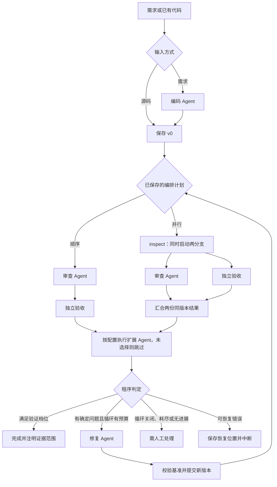

# Codelens_Pro 系统设计

本文对应可运行实现。本轮扩展包括模板式可视编排、真实并行检查、任务合同注册表、便携功能验收及版本证据追踪；是否经过真实模型验证另见验证记录。

## 三个核心角色、可选扩展与两个入口

| 角色 | 输入 | 输出与责任 |
|---|---|---|
| CodingAgent | 用户任务、公开接口合同 | 完整 Python 源码；不赋予最终通过状态 |
| ReviewAgent | 当前代码、任务、工具证据 | 问题、待确认项、需求核对；不直接改代码 |
| FixAgent | 同哈希代码、确定目标、验证反馈 | 绑定基准哈希的完整修复源码、修改说明、未解决项 |
| 验收解读 Agent（可选） | 同版本审查与验收结果 | 解释风险与下一步，不改变源码或通过判定 |

核心与扩展角色可以使用同一模型服务，分别维护提示和结构化交接。原 CodeLens 的初审和反思仍属于审查角色内部；独立验收、条件判定及汇合不是额外 Agent。

从需求生成时先编码；上传已有代码时跳过编码，由审查和修复角色协作。首次通过时可直接结束，不为了凑齐角色而制造缺陷或改动。



## 分层与可视编排

`app.py` 通过 `WorkflowRunService` 创建、读取、执行和恢复运行。LangGraph `StateGraph` 管理节点和路由，SQLite `SqliteSaver` 同步提交检查点。模型适配、验证器、TaskSpec 注册表及界面分别实现。

`ui/workflow_editor.py` 提供节点按钮、流程图预览和以下实际执行选项：

| 选项 | 实际含义 |
|---|---|
| `parallel_checks` | 顺序审查→验收，或两个独立分支并行执行后汇合 |
| `enable_repair` | 允许修复循环，或保留问题后停止 |
| `max_fix_rounds` | 0～2 轮业务修复上限 |
| `pause_after_review` | 顺序在首次审查提交后暂停；并行在首次汇合提交后暂停 |
| `extension_nodes` | 从已注册角色中选择最多 4 个，在检查后、程序判定前按顺序执行 |

计划经 `WorkflowConfig` 校验后冻结到运行状态。修改新任务的界面设置不改变历史运行。此编辑器基于固定节点模板，可以选择已注册的扩展角色；不能任意拖拽、连线、上传插件代码或重排核心阶段。

并行 `inspect` 使用两个线程，分别获得当前状态的副本；主线程收集结果并合并增量用量，统一写回图状态。修复必须等待审查与验收汇合。相同源码哈希的成功分支可在故障恢复时复用，失败分支重试。保存两分支的起止时间；界面的“重叠”来自同版本时间区间交集，不从图形并排推断实际并发。

## 可运行的服务例子

```python
from workflow import WorkflowRunService
from workflow.examples import ORDER_TASK

service = WorkflowRunService("data/example.sqlite3")
run_id = service.create_run(
    task=ORDER_TASK,
    mode="demo",
    acceptance_id="orders-v1",
    validation_profile="static_only",
    workflow_config={
        "parallel_checks": True,
        "enable_repair": True,
        "max_fix_rounds": 2,
        "pause_after_review": False,
        "extension_nodes": ["acceptance_explainer"],
    },
)
snapshot = service.execute(run_id)
service.close()
```

`demo` 只为带演示标记的订单和文本统计合同提供固定角色产物，不支持任意自定义任务。自定义目标使用真实模型与明确任务；需要功能验收时必须绑定已注册合同。`model_factory(role, settings)` 和 `validation_runner` 可注入，用于替换适配器和离线回归。

## 状态、版本与交接

状态保存任务及哈希、输入方式、计划、验收合同及哈希、当前指针、不可变代码版本、审查/验证历史、修复产物、预算、事件、错误和恢复位置。完整代码与当前指针在同一检查点提交，不另建第二份“当前源码”。

用户任务决定权限与目标；源码注释、文档字符串和历史改进说明不能自行升级为用户要求。FixAgent 只接收一份当前源码，同哈希的确定修复目标、非阻断建议、待确认项分开传递。旧哈希的修复响应或审查/验证不能授权当前版本通过。

没有实质修改且仍有具体目标时，同一预算内最多再判断一次；注释、格式和文档字符串变化不算功能修复。确实缺少信息或意见不成立时允许不改并说明原因，不能强制制造红绿差异。准确率、速度等效果没有同条件测量时保持未知。

## 运行中通知与持久证据

`on_event` 会接收临时 `node_start`、分支结束通知，以及提交后的 `node_end`。临时快照带 `transient=True`，只用于“正在执行”高亮；它仍展示最近已提交产物，不能当作新源码或新验收结果。SQLite 提交完成的结束快照才可用于结果判断。

并行的单分支结束通知也可为临时状态；只有汇合节点提交后，两分支的结果才一起进入持久状态。`events` 保存已提交节点记录，`branch_timings` 保存真实分支区间。

## 问题到修改的证据等级

`ui/evidence.py` 用“源码哈希＋问题 ID＋诊断身份”绑定历史问题。页面可选择某条问题，查看原版本行号、原样证据、FixAgent 声明的处理关系、新版本与相交修改块。

三个结论必须分开：模型声明处理；后续复查未再检出同类问题；该版本实际功能用例通过。标题/规则匹配和行段交集是有限的关联方法，不是单个缺陷已被证明修复。红绿差异仅证明文本增删。

## 验收合同与执行边界

`workflow/registry.py` 注册订单、文本统计、稳定去重、限幅、游程、区间合并、括号、滑动均值、ASCII 标识和词频共 10 个 TaskSpec。任务接口和公开合同进入状态；参考实现和独立审核用例不进入 Agent 消息。公开验收可反馈给工作流；holdout 只由评测模块在工作流结束后使用。

| 档位 | 执行方式 |
|---|---|
| `static_only` | AST、Ruff 和合同接口检查，不执行候选 |
| `functional_portable` | 附带 CPython 3.13.15 WASI，经 Wasmtime 执行公开纯函数用例 |
| `functional_required` | 保留的 Docker 订单验收，本机未完成实际 Docker 测试 |

便携归档在使用前核对固定 SHA-256，只预开标准库和本次工作区两个只读目录，不向 guest 提供宿主密钥或网络能力。时间、指令、内存和输出受限。guest 只返回实际值、异常类型和调用后输入，期望值留在宿主比较；不接受候选自报“通过”。它面向正常生成的标准库纯函数，不是不可作弊的对抗评判器，也不提供摄像头、TensorFlow 或任意系统依赖。

## 恢复、预算与导出

`execute(..., stop_after="review")` 在顺序节点提交后暂停；并行时映射为汇合 `inspect` 后暂停。恢复同一运行沿用预算和已提交版本，外部调用与本地提交之间没有分布式事务，不能承诺外部请求严格只发生一次。

默认业务修复最多 2 轮，总预算为模型调用 30 次、token 100000、活动时间 300 秒。HTTP 重试、格式修正、无进展复核和业务修复分别记录，但受同一运行总预算约束。

`retry_repair` 为已结束且仍有当前版本确定修复目标的记录新建关联运行，保留原始/当前版本及带来源标记的历史，并使用明确的新预算。用量展示本轮、继承来源和已记录合计，不能把新预算误当作旧用量被清零。

UI 可下载当前完整源码和 Markdown 运行报告；Markdown 提供版本哈希、计划、目标、结果、用量与问题关联，不附完整源码或连接配置。`export_json(run_id)` 提供完整本地快照，可能包含源码，不应混入公开发行包。用户源码、数据、API Key、数据库和个人运行报告均不打包。

`completed_static` 表示功能未验收；`completed_verified` 需当前代码的实际用例通过且没有阻断项，低优先级待确认建议仍可展示；`needs_attention` 保留阻断性未知、无进展或预算耗尽；`blocked` 表示可恢复环境错误。已有真实修复单例和真实 WASI 合成烟测；真实模型批次结果与测试数量见验证记录，不能据此保证任务泛化效果或课程分数。

## 可注册角色、节点记录与失败用例（2026-10-17）

`WorkflowConfig.extension_nodes` 保存检查汇合后执行的节点顺序；`NodeRegistry` 动态注册图节点，统一 NodeInput/NodeOutput、声明读取与命名空间写入。内置验收解读 Agent 已通过真实模型运行验证。图的路由器不逐个判断新增角色名；核心源码写入角色仍保留专用适配器。插件版本清单随运行冻结，缺失/版本不符明确停止。详见 AGENT_EXTENSIONS.md。

`node_runs` 持久记录开始/结束时间、耗时、修复轮次、输入/输出交接、错误与用量；并行分支各自计时，汇合耗时与分支耗时不能相加。预览与执行共用 `ui/execution_graph.py`，实际路由由已完成节点记录决定，高亮来自运行通知；点击节点选择某次执行。旧记录没有节点耗时就明确显示未记录，不补造数据。

`validate_configuration` 在创建和恢复前检查档位/合同兼容性，不消耗模型预算。旧不合法配置终止为 needs_attention / invalid_configuration，不提供无效的重复继续。

验收失败以源码哈希＋V-用例ID关联；Fix 的 addressed_finding_ids 与相邻版本谱系分开标记。重新验收必须绑定目标版本且存在同一用例 ID；功能用例还要求实际执行。缺失、跳过、环境错误、旧哈希均不能展示为已修复。没有定位行的用例不伪造源码行号。
