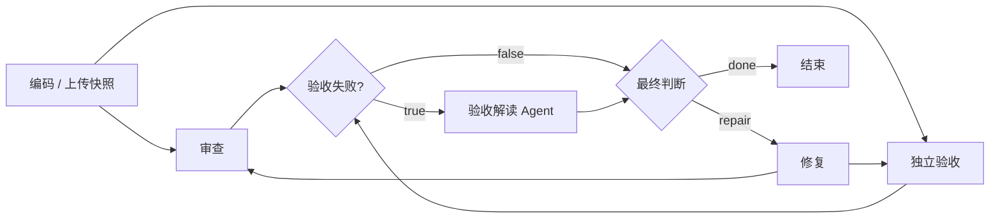

# 可执行的 Workflow 画布

在主页面“可视化流程编排”中勾选 **使用拖拽连线画布执行**。拖动卡片调整位置，从右侧实心端口拖到目标左侧空心端口建立连线；选择连线后可以删除或修改出口条件。点击 **应用画布** 后，服务端校验通过的配置才能执行。画布可导入、导出为 JSON，不依赖外部前端 CDN。

## 能做什么

- 改变检查节点的顺序，例如先验收再审查。
- 一个节点连接多个后续节点，实际并行执行所有满足依赖的分支；汇合节点等待每条输入路径完成或明确跳过。
- 添加已注册 Agent，配置串行或并行位置。读取审查 / 验收结果的 Agent 必须放在相应节点之后。
- 添加条件节点，判断“验收存在失败”“审查发现问题”或“始终为真”；`true` / `false` 出口控制实际执行与跳过。
- 通过 `gate → fix → 检查入口` 形成有次数和预算限制的修复循环。
- 保存节点位置、配置指纹、当前轮实际路由、节点耗时、分支决策、失败原因及输入输出交接。点击运行图节点查看全部执行轮次。

例如，先让审查与验收并行，汇合后只在验收失败时调用解释 Agent：

## 执行语义

`workflow/canvas.py` 校验有向图与节点依赖；`workflow/canvas_runtime.py` 从冻结配置计算可执行节点集合。没有前置依赖的节点先执行，普通多出口表示 fan-out；每条输入边解析完成后，有至少一条激活路径的节点才执行，否则标记为跳过。条件选择来自实际保存的审查或验收状态，不由模型自由决定。

每个并行节点读取同一波次的状态副本。审查结果、验证结果和扩展节点的命名空间分别合并，扩展不能更改源码或最终通过状态。并行模型节点保守地平分剩余调用 / token 配额，避免每个分支都把全部余额当作自己的预算；总活动耗时按波次墙钟时间累计。

每波完成后由 LangGraph 写入 SQLite 检查点。如果一个分支报错，成功分支的结果和执行游标一起提交，继续时只重试未成功的分支。暂停也落在波次边界。进程在波次提交前被强制终止时，该波仍可能重新执行；当前没有跨进程的外部副作用去重协议。

修复成功后，清空本轮检查游标及扩展输出，用新的源码哈希重新运行检查子图。原版本、交接和边记录保留。画布 JSON 的 SHA-256 随运行冻结；恢复前再次校验，配置被改动就拒绝继续旧运行。

## 明确边界

这是面向代码审查的可执行画布，不是任意代码执行平台。当前最多 24 个节点、64 条边；核心角色各一个，支持已注册的可信扩展。编码只在需要生成源码时执行，审查与独立验收不能放进可跳过分支；写源码和最终判定仍由指定节点负责。

检查子图支持任意合法的顺序、并行与条件拓扑，但只允许预定义修复回路，不能引入任意无界循环、嵌套循环或上传 Python 作为条件表达式。条件合流采用“等待全部路径解析、任一激活即执行”的规则。没有跨机器分布式调度、多人同时编辑或第三方不可信插件隔离。

## 验证

自动化测试覆盖改线改变执行顺序、实际并行重叠、条件跳过、修复后重新验收、非法图启动拦截、关闭重开后的恢复、配置篡改拦截及前后源码差异。

浏览器人工操作验证包括拖动节点并应用、拖出额外循环并被拒绝、撤销后恢复有效配置，以及从画布执行订单修复闭环。独立故障注入记录见 [recovery-probes.json](../evals/results/recovery-probes.json)，其中 API 调用为零，不能当作模型效果数据。
